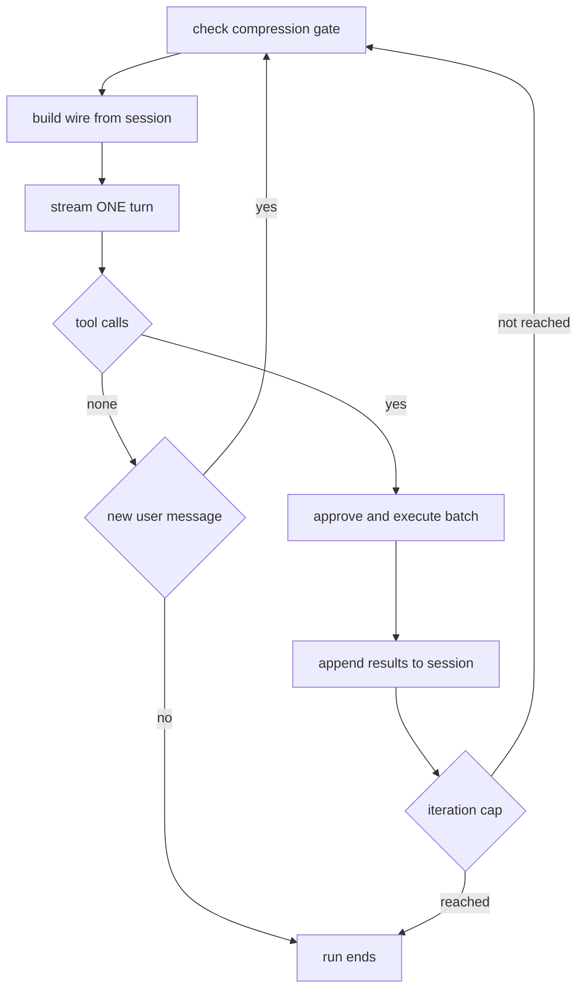
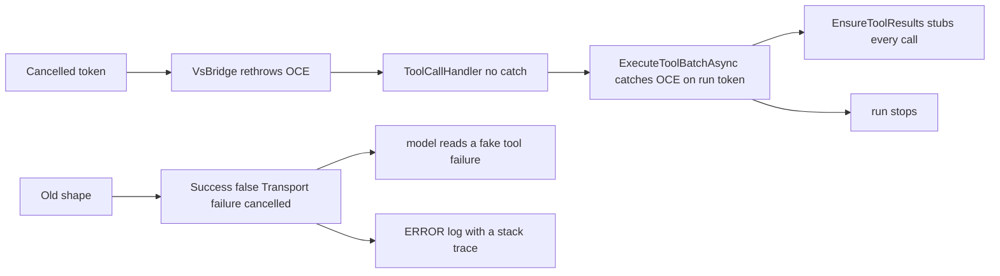

# Agent turn loop

How one agent run is driven: who calls the LLM, what happens between calls, and why the loop is
not inside the gateway.

## The single invariant

> Before every LLM turn the request is rebuilt from the session. There is no cached history.

`ChatService.GetTurnCompletionsAsync` does exactly four things:

1. `resultCapture.Reset()` — a turn starts from a clean per-call state.
2. `systemPromptBuilder.PrepareSystemPromptAsync(session.Mode)` — cached, see
   [session-and-context.md](session-and-context.md#system-prompt-cache).
3. `session.BuildWire(systemPrompt, contentFilter, live)` — the validated request history.
4. One gateway call, streamed outwards. **No tool execution.**

Everything that makes an agent "agentic" — approving a tool, running it, appending its result,
deciding to continue — belongs to the caller.

## Who is the caller

Two callers, same shape:

| Caller | Loop | Entry point |
|--------|------|-------------|
| Main agent | `AIChat.RunTurnsAsync` | user sends a message |
| Sub-agent branch | `AfSubAgentOrchestrator.RunBranchAsync` | `delegate_task` tool call |

Each iteration:

```
check compression → build wire → stream one turn → collect tool calls
      → approve + execute → append results → repeat
```

The main agent's iteration body is `RunSingleTurnAsync`; the branch's is `RunBranchTurnAsync`.
Both own a per-turn message, both own the retry protocol of that turn, and both close the message
in a `finally`.



## What must not come back

Two shapes are forbidden, and both were shipped once:

1. **A frozen wire history.** If the caller builds a request list once per run and appends to it,
   then compression, message edit, message deletion and an interject become invisible to the model
   until the next run — they mutate the session, not the copy.
2. **Tool execution inside the gateway.** Approving, running and appending a result inside the same
   call that streams the turn forces every later mechanism to be indexed against the loop's own
   state: which calls were already executed, what the turn start was, whether the compression gate
   already fired, whether an empty placeholder was hidden. Each of those indices is a second source
   of truth against the session, and each one produced a user-visible bug when it drifted.

Rebuilding the request per turn removes the second source of truth instead of synchronising it.
Consequences worth knowing when editing:

- A mutation is picked up by the **next** turn. That is the contract, not a delay to work around.
- Nothing needs to be invalidated after an edit. If you find yourself writing invalidation logic,
  the cached thing should not be cached.
- `VisualChatMessage` objects are the single source of truth, and `BuildWire` **mutates them**
  (orphan tool-call stubs) so the UI shows the same stubbed result the model sees.

## Traps

**Retry wraps one turn, never the run.** `HandleErrorAsync` (main) and the `catch` in
`RunBranchTurnAsync` (branch) re-enter the same request with a fresh message. Recursing into the
run loop would start a second run whose token cancels the first. The branch routes BOTH failure
kinds through `TrySpendRetryAttemptAsync` (exception, empty turn), so the run-level counter stays
the only source of truth for how many attempts are left.

**A message is closed in `finally`, always.** `ProcessStreamAsync` sets `IsStreaming = false` and
stamps final timings on cancellation and on failure, not only on success. A message left streaming
is filtered out of `BuildWire` and stays on screen as a frozen bubble.

**The per-turn message is created lazily — in the BRANCH only.** A branch turn enters the branch
history on the first payload (`Materialize`), so a turn that produces nothing leaves no bubble and
"no output" needs no placeholder and no flag to hide it
([session-and-context.md](session-and-context.md#empty-assistant-turns)). The main agent is the
opposite on purpose: its bubble is added EAGERLY, before the first token, because it is the only
feedback that the run started and the only place the Cancel button and the retry countdown can live.
What the two share is the removal: a turn that ends without payload is deleted again (branch: never
entered; main agent: `RemoveMessage`), so neither loop can persist an empty assistant turn.

**A turn that produces nothing is an ATTEMPT, not an answer.** No content, no reasoning and no tool
call means the model answered with nothing — providers do that (an empty `delta` with
`completion_tokens: 0` is dropped by the mapper, so the stream just ends). Both loops retry such a
turn on the SAME budget a thrown failure spends, otherwise the run either ended silently (main
agent) or reported `(Sub-agent returned an empty response.)` to the parent
([llm-transport.md](llm-transport.md#an-empty-turn-is-retried-too)). Reasoning counts as payload: a
reasoning-only turn is a legitimate answer, not an empty one. When the budget is gone the two loops
part way, and neither fabricates an answer: the branch reports the empty marker plus an attempt
count to its parent, the main agent leaves a terminal technical note. A visible assistant bubble was
tried and rejected — it is ordinary assistant speech, so the model would read our diagnostic as its
own last utterance on the next turn.

**Tool calls are read per turn.** `resultCapture.AccumulatedToolCalls` is reset at the start of
every turn, so a turn cannot execute the calls of a previous turn. The main agent additionally
re-reads the capture immediately after the stream, because the last delta and the capture can
disagree when a provider delivers the final arguments in the closing chunk.

**Nothing executes mid-stream.** A delta only accumulates arguments; the batch runs after the turn
has ended and the message is closed. Executing from a delta would fire on partial arguments and
then fire again for the same call.

**Approval gates are prepared once per batch, before the first execution.**
`ToolCallHandler.PrepareToolsForApprovals(calls)` sweeps expired early approvals, cancels the
previous batch's waiters and pre-registers a gate per pending call, which is what lets the user
approve the calls of one batch in any order. Calling it per call instead would cancel the gate of
every sibling call still waiting, so an approval given for the second tool would be discarded while
the first one runs.

**Mode switches change the next turn, not the current one.** `switch_mode` executes between turns;
the next `BuildWire` call resolves tools from the session's *current* mode. A tool batch is split at
the switch so the remainder runs under the new mode — the handler receives one mode per call.

**Iteration caps are per caller and independent.** `MaxIterationsPerSubAgent` (default 50, `0` =
unlimited) applies to branches only; there is no cap on the main agent. A capped branch still
executes the calls of its final turn — their results belong in the history.

**Cancellation is never translated into a tool result.** A `Cancelled` outcome means "the tool was
never finished", and it must stay an `OperationCanceledException` on the run token all the way up:



Only the two run loops own the terminal state: they catch OCE on the run token and then stamp a
result on every remaining call of the batch (the API rejects an `assistant(tool_calls)` turn without
matching tool messages). Any transport that swallowed cancellation into `Success = false` broke that
contract twice — the model received "Transport failure: The operation was canceled." as the tool's
answer, and the batch kept unwinding one call at a time instead of stopping at the next check.

**Inline think blocks are parsed per DELTA, so slices go by first occurrence.** Kimi/DeepSeek send
the reasoning inside `Content` as `<think>…</think>`; `AfUsageHelpers.ProcessThinkBlocks` splits it
into `ReasoningContent` + `Content` and carries two flags across chunks. Two rules are load-bearing:

- **Slice, never `Replace`.** `Replace` removes every occurrence in the chunk, so a chunk that
  mentions the tag twice (the model explaining the protocol) lost text that belongs to the answer.
- **A chunk inside the block carries BOTH halves.** Everything before the first closer is
  reasoning, everything after it is the answer — putting the whole chunk into `Content` leaked the
  model's thoughts into the visible answer.

The opening tag may only open a block before the first chunk of the turn is classified, so the
helper SPENDS that window (`isStart = false`) instead of leaving it armed for the whole turn. Known
limitation: a tag split across two deltas (`"<thi"` + `"nk>"`) is not detected — that needs a
buffered seam in `AfDeltaMapper`, not a smarter pure function.

## What the parent reads back

One `delegate_task` call produces ONE tool message, and `BuildWire` sends only its
`ToolResult.Content`: `Success` lives in the UI (the ❌/✅ badge) and never crosses the wire, so every
fact the parent has to act on must be in the text.

`ToolResult.Convert` owns that text, and the text is `Result` whenever it is non-empty — a
whitespace-only payload counts as none. `ErrorMessage` is the FALLBACK for a result that carries no
payload (the shape of `VsToolResult.Failed`). The older rule, `Success ? Result : ErrorMessage`, read
the flag as "which field is the answer", which held only while a failure had no payload: the first
tool that reported a PARTIAL outcome lost the payload entirely. That tool is `delegate_task`, and
what it lost was a whole batch — a parent that delegated three tasks and lost one received
`One or more delegated task(s) failed.` instead of the two finished answers.

`AfSubAgentOrchestrator.ComposeResult` builds the report, `FailedTasksSummary` the one line naming
the failed tasks:

| Batch | `Success` | What the model reads |
|---|---|---|
| one task, completed | true | the branch answer, plus whatever limit note it appended |
| one task, failed | false | `(Sub-agent branch failed: <reason>) Last response: <its last answer>` |
| several tasks, none failed | true | one `### Task N: <short task>` block per branch |
| several tasks, some failed | false | the same blocks, then `N of M delegated task(s) failed (Task …).` |
| no task parsed | false | `Result` is empty, so the `MissingTasksError` sentence |
| cancelled after some branches produced text | false | the blocks that exist, then `(Cancelled: the remaining branches did not finish.)` |

The summary is a TRAILER, not a header: `ToolResult.TruncateContent` keeps the TAIL of a result past
300 KB and drops the beginning, so a header would be the first thing a big batch lost — together
with the earliest tasks' blocks. Each block already names its own failure, so the summary is a
convenience, one that survives the cut.

A CANCELLED batch is its own outcome: `ComposeAnsweredBlocks` reports every branch that got as far as
producing text — an answer, a limit note or a failure report — and appends
`(Cancelled: the remaining branches did not finish.)`, because that text is the only work that
survives the run. A batch where nothing produced text yet still returns plain
`VsToolResult.Cancelled`. The notice says "cancelled", not "cancelled by the user": a nested batch
sees the OUTER branch's time limit on its own token, so no user is involved there.

**Only an exception makes a branch FAILED.** A branch that stopped at the time limit, the iteration
cap or the token budget counts as finished: its block carries the note it appended, it is absent
from the `N of M` line, and the batch keeps `Success = true`. One failed branch is enough to turn the
batch into `Success = false`: the tool call completed, but not with what the parent asked for.

A branch that died mid-run keeps what it answered before — `LastResponseSuffix` reads the last
assistant message WITH content, because a branch that answered and then issued a tool call ends on a
contentless tool-call turn. That partial answer is the only part the parent can still use, and the
same suffix reports the last answer next to the time limit.

`ErrorMessage` always carries that same `N of M …` sentence — for a single failed task too, where
the report itself has no trailer. Nothing reads it for this tool (the payload exists, so `Convert`
never falls back), but a `VsToolResult` reporting failure with an empty reason is the shape
`VsResponse` forbids, and a future consumer of `Success` would otherwise see a failure with no words
at all.

Nested batches compose the same way one level down: the branch's model reads the same shape. And the
batch is composed even when the batch PLUMBING breaks (a UI subscriber throwing inside `Finish`):
`RunBatchAsync` catches that separately from cancellation and reports what finished, instead of
replacing the whole delegation with "The tool call was not executed".

## Related

- Transport, timeouts and retries: [llm-transport.md](llm-transport.md)
- What `BuildWire` validates: [session-and-context.md](session-and-context.md)
