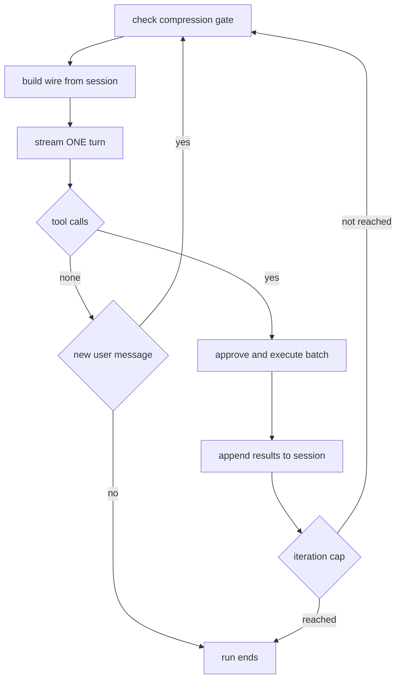

# Agent turn loop

How one agent run is driven: who calls the LLM, what happens between calls, and why the loop is
not inside the gateway.

## The single invariant

> Before every LLM turn the request is rebuilt from the session. There is no cached history.

`ChatService.GetTurnCompletionsAsync` does exactly four things:

1. `resultCapture.Reset()` — a turn starts from a clean per-call state.
2. `systemPromptBuilder.PrepareSystemPromptAsync(session.Mode)` — cached, see
   [session-and-context.md](session-and-context.md#system-prompt-cache).
3. `session.BuildWire(systemPrompt, contentFilter, live)` — the validated request history.
4. One gateway call, streamed outwards. **No tool execution.**

Everything that makes an agent "agentic" — approving a tool, running it, appending its result,
deciding to continue — belongs to the caller.

## Who is the caller

Two callers, same shape:

| Caller | Loop | Entry point |
|--------|------|-------------|
| Main agent | `AIChat.RunTurnsAsync` | user sends a message |
| Sub-agent branch | `AfSubAgentOrchestrator.RunBranchAsync` | `delegate_task` tool call |

Each iteration:

```
check compression → build wire → stream one turn → collect tool calls
      → approve + execute → append results → repeat
```

The main agent's iteration body is `RunSingleTurnAsync`; the branch's is `RunBranchTurnAsync`.
Both own a per-turn message, both own the retry protocol of that turn, and both close the message
in a `finally`.



## Why the loop left the gateway

The previous design ran a `FunctionInvokingChatClient` inside the gateway (`AfAgentLoop`). It
froze the wire history on entry and executed tools in the chat-client pipeline. Three consequences,
all of them bugs the user could see:

1. **Between-turn mutations never reached the model.** Compression, message edit, message deletion
   and an interject all mutate the session. The loop held its own `List<ChatMessage>` built once at
   run start, so every one of those changes was invisible until the *next run*.
2. **Compression re-fired every turn.** `CaptureUsage` rebased `session.TotalTokens` from provider
   usage, which overwrote the value the compression path had just re-armed — so the gate saw "still
   over the limit" at every turn boundary and re-summarised the already compressed history.
3. **Two sources of truth for "what the model sees".** Any fix required keeping the loop's list and
   the session in sync by hand, with an index (`ToolsExecutedByAgent`, `IsStartOfTurn`,
   `IsEmptyTurn`, `CompressionGate`) per mechanism.

Rebuilding the request per turn removes the second source of truth instead of synchronising it.
Consequences worth knowing when editing:

- A mutation is picked up by the **next** turn. That is the contract, not a delay to work around.
- Nothing needs to be invalidated after an edit. If you find yourself writing invalidation logic,
  the cached thing should not be cached.
- `VisualChatMessage` objects are the single source of truth, and `BuildWire` **mutates them**
  (orphan tool-call stubs) so the UI shows the same stubbed result the model sees.

## Traps

**Retry wraps one turn, never the run.** `HandleErrorAsync` (main) and the `catch` in
`RunBranchTurnAsync` (branch) re-enter the same request with a fresh message. Recursing into the
run loop would start a second run whose token cancels the first.

**A message is closed in `finally`, always.** `ProcessStreamAsync` sets `IsStreaming = false` and
stamps final timings on cancellation and on failure, not only on success. A message left streaming
is filtered out of `BuildWire` and stays on screen as a frozen bubble.

**The per-turn message is created lazily.** It enters the session on the first payload
(`Materialize`). A turn that produces nothing leaves no bubble — this replaced the eager
`onNewTurn` placeholder plus the `IsEmptyTurn` filter that hid it.

**Tool calls are read per turn.** `resultCapture.AccumulatedToolCalls` is reset at the start of
every turn, so a turn cannot execute the calls of a previous turn. The main agent additionally
re-reads the capture immediately after the stream, because the last delta and the capture can
disagree when a provider delivers the final arguments in the closing chunk.

**Mode switches change the next turn, not the current one.** `switch_mode` executes between turns;
the next `BuildWire` call resolves tools from the session's *current* mode. A tool batch is split at
the switch so the remainder runs under the new mode — the handler receives one mode per call.

**Iteration caps are per caller and independent.** `MaxIterationsPerSubAgent` (default 50, `0` =
unlimited) applies to branches only; there is no cap on the main agent. A capped branch still
executes the calls of its final turn — their results belong in the history.

## Related

- Transport, timeouts and retries: [llm-transport.md](llm-transport.md)
- What `BuildWire` validates: [session-and-context.md](session-and-context.md)
