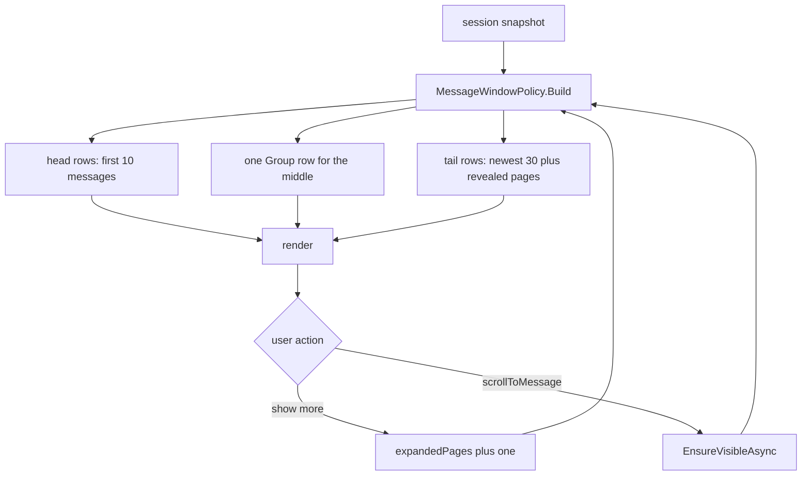
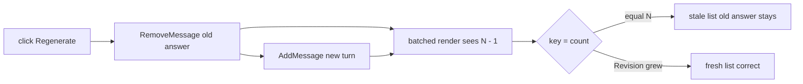
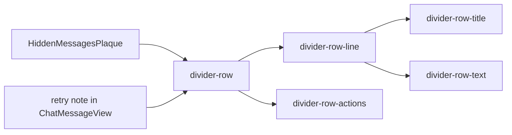

# Message window

How the main transcript keeps a 500-message session renderable: what is materialised in the DOM,
what is folded behind the archive plaque, and why every decision in `MessageWindowPolicy` exists.

The window is a **display-only** fold. `BuildWire` is untouched: the model receives the whole
history while the user sees `[head][plaque][tail]`. Teaching compression or the wire builder about
the window would turn a rendering optimisation into a data-loss bug.

## The symptom it fixes

WebView2 reported `RenderProcessUnresponsive` on sessions of several hundred messages. Three cost
centres, all of them linear in the message count and all of them on the **single WASM thread**:

| Blocking point | Owner | Why it blocks |
|----------------|-------|---------------|
| One synchronous `BuildRenderTree` pass over the whole transcript, one `ChatMessageView` per message | `MessageListView` | There is no `await` inside the pass. The renderer never yields, so the browser never gets a slice to answer the watchdog. |
| One JS interop per markdown block: `marked.parse` of the full text plus an `innerHTML` replacement | `MarkdownBlock` | Every hop is a cross-context call; the interop queue drains sequentially, so 500 blocks are 500 serialised round trips behind one render. |
| Eager presentation preparation over the whole history at load: `<plan>` regex, segment building, tool display-name resolution | `MessagePresentation` | Pure CPU on the same thread, paid *before* the first paint of a session that the user may only scroll to the bottom of. |

The three multiply. Windowing removes the first and third outright and removes the second for
every folded message, because a message that is not in the plan is never a component in the tree.

The fourth historical cost — one parent re-render per token over the whole list — was already
answered differently, by `VisualChatMessage.Changed` letting a single bubble repaint itself. Keep
both: the window bounds *load* cost, the per-message subscription bounds *streaming* cost
([render-performance.md](render-performance.md)).

## The layout

`WindowRow` carries a **real** index into the session snapshot, never an index into the visible
window. Every positional decision (`IsLast`, "is this the message the user edited") therefore keeps
its meaning while the middle is gone — the one thing a naive `index`-based fold always breaks.

### Why the head is always visible

The head is where a task starts. It is what the user scrolls back to when the agent looks like it
misunderstood something, and it is the only part of a long history that is read out of order.
Hiding ten bubbles there to save ten bubbles of render is a bad trade — and it is the part of the
history a fold is most likely to make unreachable, because "show earlier" on a plaque above the
head has nowhere to expand to.

### Why the middle is folded, not deleted

A silently missing block of history reads as data loss. This lesson was already paid for on
compression, so the fold states its own size: `N messages · K tool calls · ~T tokens`, with a note
that the model still receives them. The plaque is deliberately a thin divider rather than a bubble,
so it can never be mistaken for something the assistant said.

### Why one plaque row

Per-message collapsing was rejected: it produces N toggles instead of one statement, it makes the
transcript's scroll height depend on N independent pieces of state, and it still leaves N
components in the tree — which is the cost being removed.

## Constants

| Constant | Value | Rationale |
|----------|-------|-----------|
| `HeadWindowCount` | 10 | Enough to hold the task message and the first exchange. Below ~6 the head stops containing a question plus its answer. |
| `TailWindowCount` | 30 | One screen of work. Sized so the last tool batch of a run plus its assistant reply is visible without touching the plaque. |
| `GroupPageSize` | 30 | Equal to the tail on purpose: one click moves the boundary by exactly one screen, so "scroll up" never lands the reader mid-gap. |
| `MinHiddenCount` | 20 | Below this the plaque costs more attention than it saves. A 28-message chat renders whole. |

`MinHiddenCount` composes with the fold gate in a way that is easy to misread: the fold appears at
`HeadWindowCount + TailWindowCount + MinHiddenCount` = 60 messages, not at 30, because until the
tail window is full there is nothing in the middle to hide.

## The protected set

`IsProtected` answers one question: **would the user have to do something inside this bubble for the
system to make progress?** If yes, the bubble stays in the DOM no matter what the window maths says.

| State | Why it must stay visible |
|-------|--------------------------|
| `IsStreaming` | The user is watching the answer being written. Folding it mid-run replaces live text with a plaque. |
| `ApprovalStatus == Pending` | The approve button lives in the block. Folded, the run waits forever behind a plaque that does not say it is waiting. |
| `ToolCall.IsExecuting` | A running tool owns the only progress signal (the elapsed/timeout badge) the user has. |
| `ask_user` without a `Result` | The answer widget is the block; the run is parked on it. |
| Sub-agent branch `Pending` / `Running` / `NeedAction` / `Paused` | The branch is a live process rendered *inside* the parent bubble. `NeedAction` and `Paused` additionally wait for the user. |

**An approval behind the plaque is an invisible hang**, and it is the reason the protected scan runs
*before* the statistics are computed. The scan walks from the head forward, stops at the first
protected message, and cuts the group there — so the protected message becomes the first tail row.

The scan composes with `MinHiddenCount` rather than overriding it: if the cut leaves fewer than
`MinHiddenCount` rows hidden, there is no group at all and the whole history renders. The invariant
"never hide a gate" outranks "always hide the middle" — a small fold that would swallow an approval
is simply not a fold.

Only the hidden range is scanned. A protected message that already sits in the tail changes nothing,
which is also the reason `EnsureVisibleAsync` can legitimately return `true` without expanding
anything: a protected message pins the boundary, so it is already materialised. The method returns
`false` only for an id the session does not contain.

## Hysteresis: the pin around a run

`DesiredTailStart` grows monotonically with the message count: an unpinned boundary **moves forward
and hides more** as messages arrive. During a streaming run that is exactly wrong — the boundary
would swallow the bubble the user is reading, and the browser scroll position would jump with it.

So `MessageListView` pins the boundary at the start of a run:

1. `IsLoading` turns true → `pinnedTailStart = DesiredTailStart(count, expandedPages)`.
2. `Build` takes `min(pin, desired)`. A pin can therefore only ever **reveal**, never hide, so a
   stale pin is always safe.
3. `IsLoading` turns false → the pin is dropped and the normal boundary applies.

### The one-page jump compromise

A run that grows more than `TailWindowCount + GroupPageSize` (60 messages) beyond the pin re-pins
forward. This is a deliberate compromise between two failures:

- **Never re-pin** → an unbounded tail during long runs; a 300-message run ends up fully
  materialised, which defeats the window exactly when it matters most.
- **Re-pin every message** → the boundary creeps forward under the reader, the original jump.

One jump per page of growth is far less disruptive than a freeze that never ends, and it is
predictable: the reader is never more than one page away from the boundary they were watching.

Scroll anchoring is handled explicitly (`captureChatScrollHeight` / `restoreChatScrollHeight`):
`.rz-chat-message` and the plaque opt out of `overflow-anchor`, so revealing rows *above* the
viewport would otherwise leave the reader's scroll position pointing at different content.

## Main session only

Sub-agent branches are **not** windowed. They render inside `SubAgentView`, which owns their
lifetime, their head (the task) and their live tail; an orchestrator iteration cap bounds their
growth, and the user watches a branch precisely where the window would divide it. Windowing a
branch would hide the two ends it consists of.

Consequence for future work: if a branch ever grows unbounded, give `SubAgentView` its own plan —
do **not** reuse `MessageListView`. Its `_prepared` set is keyed by message id and assumes it is the
only owner of the presentation state of the messages it renders.

## Lazy presentation preparation

`PrepareMaterialised` runs `MessagePresentation.Prepare` only over `MaterialisedIndices(plan)`,
tracked in a `_prepared` set of message ids, and never runs twice for the same message.

Two invariants follow, and both are load-bearing:

- **`Prepare` must stay idempotent.** A message revealed later is prepared on its first render;
  a revealed message must look exactly like the same message did at the tail.
- **`Prepare` must never be re-run.** It resets `IsExpanded`, which would silently collapse a
  bubble the user expanded — and it is the cheapest place to break the "one long answer stays
  collapsed" behaviour without touching a single line of chat code.

The `ToolResult.DisplayName` resolution lives here (not at load time) for the same reason: after a
reload `DisplayName` is empty because it is `[JsonIgnore]`, and a revealed message must not render a
blank result header. `SessionId` change clears `_prepared`, the revealed pages and the pin.

## The transcript snapshot cache

`AiChat.GetMessagesSnapshot` caches the list it hands to `MessageListView`, keyed by
`(session instance, ConversationSession.Revision)`. The list is otherwise copied on every frame,
which at 500 messages is a measurable cost and also makes the windowed view look like a different
list on every pass.

**The key must be the revision, never the message count.** A count cannot distinguish a replacement
from a no-op, and Blazor batches every `StateHasChanged` of one event handler into a single render:

Regenerate is exactly that shape: the last assistant message is removed and the new turn message is
added inside one handler, so the render sees "N messages" before and after. With a count key the
cache answers with the pre-change list — the deleted answer stays on screen while the response streams
into a bubble that is not in the DOM, and the transcript only catches up on the *next* structural
change (the "+1 message" a user observes). `Revision` is monotonic and bumped by every structural
mutation (`AddMessage`, `RemoveMessage`, `SetMessages`, `CollapseMessages`, `UpdateMessage`,
`PurgeLegacyEmptyTurns`), so any net-zero replacement still invalidates.

Content changes are deliberately NOT in the key: they mutate `VisualChatMessage` in place, the cached
list holds the same instances, and per-token repaints go through `VisualChatMessage.Changed`
(see [message-window.md](#lazy-presentation-preparation) and `ChatMessageView`). A new cache of the
same kind must use a monotonic version too — a size, a count or a timestamp of "what got added" is
the bug described above.

## Accepted limitations

- **Find in the view (Ctrl+F, where the host offers it) does not see folded text.** The messages are
  not in the DOM — that is the whole mechanism, not a side effect. Any fix must come from a
  transcript-search feature over the session model, never from CSS.
- **Cross-group selection is impossible.** Dragging from a head message to a tail message skips the
  folded middle; the plaque is a divider, so the selection is at best partial. Revealing the pages
  is the workaround.
- **`content-visibility: auto` / `contain` on messages stays rejected.** It keeps every component in
  the tree and every markdown block still runs its interop — the actual blocking cost is paid in
  full — while making `scrollHeight`, anchoring and find behaviour browser-version dependent. The
  window is the only variant that removes work instead of hiding it.
- **The plaque's message count includes technical notes; its token figure does not.** The span size
  is what the reader lost track of, while the number that matters for context is what the model
  pays — and the model never sees a technical note.
- **A protected message can keep a large stretch visible.** Correct by design: the fold shrinks
  rather than hiding a gate.

## How to change / extend

### Add a collapse level

Two plaques ("older" / "oldest") are a policy change, not a component change:

1. Extend `MessageWindowPlan` with the second boundary (it is a `record`, so this is additive) and
   emit one `Group` row per hidden span.
2. Keep `WindowRow.Index` a **real** index for `Message` rows. `IsLast` and every callback identity
   depend on it; a row that carried a window-relative index breaks silently.
3. Keep each group row keyed stably in `MessageListView` (`@key`). A re-created plaque loses its
   `overflow-anchor: none` isolation and flickers on every render.
4. Keep the protected scan per span, and keep the `MinHiddenCount` gate per span — two plaques must
   not be able to hide one gate between them.

### Add a protected state

1. Add the condition to `MessageWindowPolicy.IsProtected`.
2. Add a unit test that the group is cut **before** the message (not around it) and a second one
   where the cut leaves fewer than `MinHiddenCount` rows, so the whole history renders.
3. Add a negative control: the same message in its terminal state must **not** be protected, or the
   fold stops working for every completed run with a sub-agent in it.

Ask the invariant question before adding one: *does the user have to act inside this bubble for the
run to continue?* "It looks important" is not a reason — a protected message shrinks the fold for
every session that ever contained one.

### Retune a constant

Treat them as UX constants, not tuning knobs. Before changing one, state the arithmetic
consequence: a larger `TailWindowCount` raises the fold threshold together with the render cost, a
smaller `MinHiddenCount` makes plaques appear on chats where they cost more attention than they
save, and `GroupPageSize` no longer matching the tail turns every "show earlier" into a jump the
reader cannot predict.

## The compress hint in the input

`CompressHint` (rendered by `AiChatInput` next to the send button) is the proactive half of the same
idea: the plaque explains a history that is already large, the hint offers to shrink it before the
next run pays for it.

- **Threshold** `MinMessages = 100`, and it stays hidden while a run streams or a compression is in
  flight - offering to rewrite the history mid-run is an invitation to a race.
- **Dismissal remembers the message COUNT, not a boolean.** A dismissed hint returns only after the
  history grew by `RemindAfterMoreMessages = 50`, so "not now" is respected until it stops being
  true. A bare flag would either nag forever or never return.
- **It reuses the existing `/compress` path** (`HandleCommandAsync(BuiltInCommand.Compress)`). The
  hint owns no compression logic of its own; the plaque's "compress" button calls the same path.
  The dispatcher normalises the incoming string (`Trim().TrimStart('/')`), so the bare name from the
  suggestion menu and a hand-typed `/compress` reach the same `case`.

## One visual language for "this is not a turn"

The plaque and the retry note are the two controls in the transcript that are *not* conversation
bubbles, and they share one set of classes (`wwwroot/css/app.css`):

- The plaque folds a hidden stretch of history; the note reports a transport event. Same geometry,
  different content - a second visual language for "not a bubble" would make both read as content.
- The action slot is the same: "show earlier" on the plaque, "dismiss" on the note. A note has no
  edit/regenerate, so the shared message action bar is suppressed for it (`!Message.IsTechnical`)
  and a lone cross under a divider would read as a stray button.
- `divider-row--warning` is the only difference: the note's icon and title carry the severity.

## Related

- What the model receives (and why the window must not touch it): [session-and-context.md](session-and-context.md)
- Who owns the turn loop, and what a streaming bubble *is*: [agent-turn-loop.md](agent-turn-loop.md)
