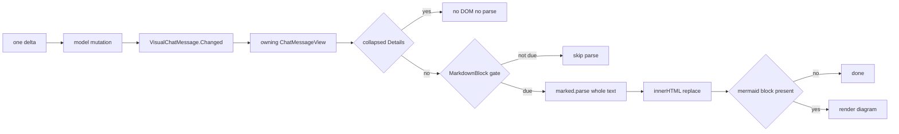

# Render performance

What one streamed token costs, which gates keep that cost flat, and the measurements behind
them. Companion of [message-window.md](message-window.md): the window bounds the cost of a
**load**, this document bounds the cost of a **token**.

Both exist because the WebView2 renderer runs everything on a single WASM thread: a component that
renders on every delta does not just look slow, it stops the browser from answering, and WebView2
reports `RenderProcessUnresponsive`.

## The cost model

The path has exactly one listener per token and every later stage may skip. Anything that adds a
listener on this path multiplies the token rate by the number of subscribers.

## Message-level notification, not a parent re-render

`VisualChatMessage.Changed` is raised on the mutated message and `ChatMessageView` subscribes to its
own message (`OnParametersSet`, reference-checked, unsubscribed in `Dispose`). A token therefore
repaints **one** bubble.

The failure this prevents is arithmetic: with the token going through the parent, every delta
re-rendered `AiChat` and called `ShouldRender` on **every** message in the transcript — ~24500
calls/s at 50 tokens/s over 490 messages, on the UI thread, plus a fresh copy of the message list
per render. The symptom was FPS 3–7 during scroll plus stream and clicks that froze.

Consequences when editing:

- **Never raise a session-level "changed" event per token.** Session-level events are for structural
  changes (add, remove, collapse) — `ConversationSession.Revision` is the monotonic key for those,
  and it is what the transcript snapshot cache is keyed on
  ([message-window.md](message-window.md#the-transcript-snapshot-cache)).
- **A `ShouldRender` override must include everything the component shows.** The transcript snapshot
  bug (regenerate: `RemoveMessage` + `AddMessage` in one batch leaves the count unchanged) is the
  same class of failure on the parent side.
- **View state is part of change detection.** A click that changes no model field must still render:
  `SubAgentView` keeps a `_viewStateChanged` flag (reset in `OnRendered`) that participates in
  `HasChanges`, raised by `RequestViewRender()`. Deriving the verdict from the model alone made the
  interject input appear only when the branch emitted its next token — and the old workaround lied
  to the model by bumping `Revision` for a pure view change.

### Testing a view-state render: bUnit JSInterop is Strict

`SubAgentView` finishes the reveal in `OnAfterRenderAsync` (`scrollSubAgentToBottom` on new
messages, `focusSubAgentInput` on the interject reveal). bUnit's `BunitJSInterop` defaults to
`JSRuntimeMode.Strict`, so **every** identifier a component calls must have a `SetupVoid`, not only
the ones an assertion checks. A missing setup throws `JSRuntimeUnhandledInvocationException` out of
the render pipeline; `WaitForAssertionAsync` races that exception against its predicate, so the test
passes or fails depending on which wins — it passed locally and failed on CI
(`Interject_InputAppearsOnClick_WithoutAnyBranchActivity`).

Two rules follow:

- **Register the whole cosmetic surface of the component under test in the fixture constructor.**
  `JSInterop.Mode = JSRuntimeMode.Loose` is the alternative the repo uses where the calls are pure
  cosmetics and nothing asserts them (`MessageListViewTests`, `ToolBashCommandTests`); a fixture that
  *does* assert invocations stays Strict and lists them.
- **Assert the interop you registered.** A setup nobody asserts turns a dropped call into a silent
  pass: the reveal test now also asserts `focusSubAgentInput` was invoked once with the branch id,
  so removing the focus call fails the test instead of leaving an unused handler behind.

## A collapsed `Details` is not in the DOM

`MessageContent` and `SubAgentView` pass `RenderContentWhenCollapsed="false"`, so a collapsed
reasoning section renders **no body at all** — no `MarkdownBlock`, no `marked.parse`, no
`innerHTML`.

This is the difference between "hidden" and "absent". `grid-template-rows: 0fr` hides the body
visually but keeps it in the tree and keeps updating it, which turned every reasoning token into a
full markdown parse plus a DOM replacement of the whole subtree (O(n²) per answer) and destroyed
any text selection inside it.

`Details` re-enables the body for `CollapseAnimationMs` (320 ms) after a collapse (`_bodyPinned`),
because unmounting the body at once kills the closing animation.

## Markdown is gated while streaming

`MarkdownBlock` renders on a hybrid gate while `IsStreaming` is set:

| Gate | Value | Reason |
|------|-------|--------|
| `StreamingRenderGrowthChars` | 100 | a growth-based gate keeps the visible tail fresh without parsing per token |
| `StreamingRenderMaxDelayMs` | 120 | the time-based half bounds latency, so a slow trickle still updates |

The last render before the stream ends is unconditional: `IsStreaming` going false always renders,
otherwise the closing tokens would be lost.

**The whole text is parsed, never a chunk.** Incremental chunked parsing was tried and rejected:
numbered and nested lists break whenever a chunk boundary falls inside them, and a markdown
document is not a concatenation of independently parseable pieces. The gate above is the
replacement for it, and it is why `marked.parse` cost (0.7–4.4 ms for 2–128 KB) never had to be
optimised.

## Mermaid is configured per theme, not per render

`markdown-renderer.js`:

- `ensureMermaidTheme()` calls `window.mermaid.initialize(...)` only when the theme actually
  changed (`mermaidThemeApplied`). It used to run on every render — i.e. once per token for any
  message containing a diagram — and it reconfigures the whole library.
- `querySelectorAll('.mermaid')` runs only when the text contains a mermaid fence. Scanning the
  block is a full subtree query and the common streaming case has no diagram at all.
- Rendered SVGs are cached by content (`mermaidCache`), so re-rendering the same diagram is a
  lookup, not another `mermaid.render`.

## Sub-agent streams: coalesce at the source

A branch raises `SubAgentMessage.StateChanged` on every reasoning and content token, and every
subscriber re-renders. Two subscribers exist (`SubAgentView` and the owning `ToolCallBlock`), so the
cost doubled and drowned the WASM sync queue.

The fix is layered, and each layer is needed:

1. **One `Throttle` per run, owned by the orchestrator** (`SubAgentUiIntervalMs` = 100 ms,
   leading mode): token-rate `NotifyStateChanged` calls are coalesced into ~10 events/s for **all**
   subscribers at once. Structural changes — attach, finish, approval, retry — fire directly and are
   never delayed.
2. **`ThrottledComponentBase` on `ToolCallBlock`** with a structural-only `HasChanges`
   (approval status, sub-agent count, result). A token mutation is vetoed; a structural change
   renders immediately.
3. **`@key="tc.Id"` on the `ToolCallBlock` loop in `SubAgentView`**: positional diffing otherwise
   attaches a block's component state to a different tool call when the list changes.
4. **`ToolCallBlock` re-keys its subscription in `OnParametersSet`** when the `ToolCall` parameter
   is replaced, so a block reused for a new call does not keep listening to the old one.

`Throttle` (`UIBlazor/Utils`) is the single trailing-guarantee primitive behind all of this, the
settings autosave and `ThrottledComponentBase`. Its two load-bearing contracts: `Dispose`/`Reset`
**drop** a scheduled trailing fire (the final state is not delivered), and only the trailing path of
`FireTrailingAsync` owns the CTS (`Notify`/`Reset`/`Dispose` only `Cancel` it).

## Measurements

Session of 490 messages / 170k context, DevTools, before the gates:

| State | FPS |
|-------|-----|
| Idle | 120 |
| Scroll, no stream | 30 |
| Stream running (reasoning) | stalls, clicks freeze |
| Scroll + stream | **3–7** |

| Measurement | Result | Conclusion |
|---|---|---|
| DevTools profile, 2500 ms | rendering 1400, scripting 700, system 300 | fix DOM rebuild, not call frequency |
| `marked.parse` on 2 / 8 / 32 / 128 KB | 0.71 / 0.57 / 1.29 / 4.35 ms | parsing is cheap; it was never the stall |
| `content-visibility: auto` on messages | FPS unchanged (30), scroll broke | the cost was not off-screen layout |

## Rejected: `content-visibility`

`content-visibility: auto; contain-intrinsic-size: auto 200px` on `.rz-chat-message` was tried and
is closed. It keeps every component in the tree and every markdown block still runs its interop —
the actual blocking cost is paid in full — while the fixed `contain-intrinsic-size` fights
`overflow-anchor`: before the first measurement the element is a 200 px placeholder, after it the
real height, and the anchor recomputes on every such change. With message heights that vary by
markdown, code and diffs the scroll jumped. Off-screen elements also stop existing for
`scrollToMessage`, `querySelector` and Ctrl+F.

The window ([message-window.md](message-window.md)) is the variant that removes work instead of
hiding it.

## Known remaining costs

Not fixed, and each needs a measurement before it is worth code:

- **`message.Content = response.ToString()` per delta** — O(n²) allocations in WASM; the fix is an
  incremental append.
- **Tool-call arguments are processed 3× per chunk** — string concat (`MapDelta`), parse per chunk,
  re-serialise (`AccumulateToolCall`), then parse again in the loop.
- **Lazy allocations** — `ChatDelta` per update even when the update maps to null, `List<AIContent>`
  per chunk including ignored Responses events.

## Related

- Load-time cost, the fold, the transcript snapshot cache: [message-window.md](message-window.md)
- Where a token comes from, and who closes the message: [agent-turn-loop.md](agent-turn-loop.md)
